# Brewlist

<p align="center">
  <a href="https://ko-fi.com/imtotallymeh"></a>
</p>

Brewlist builds Commander decks from the cards you already own,
and checks any [Moxfield](https://moxfield.com) or
[Archidekt](https://archidekt.com) decklist against your
[ManaBox](https://manabox.app) collection.

- **Build a deck** with the **Deck Builder**: pick a commander from your
  collection and Brewlist fills in the rest from what you own, using real
  EDHREC deck data, Scryfall Oracle Tags and Commander Spellbook combos. Then
  analyze it (mana curve, mana and turn-clock simulation, bracket estimate)
  and export it back to Moxfield or Archidekt.
- **Compare a decklist**: paste a deck URL to see what you already own,
  what's missing, and what it'll cost to finish at today's market prices,
  with budget alternatives, Game Changers, legality and combos.

Available two ways: a **web app** (upload a CSV, build or paste a URL, done —
no terminal needed) and the original **CLI** (menu-driven, generates
Markdown/HTML/CSV reports on disk) — the CLI only does the comparison; the
Deck Builder is web-app only.

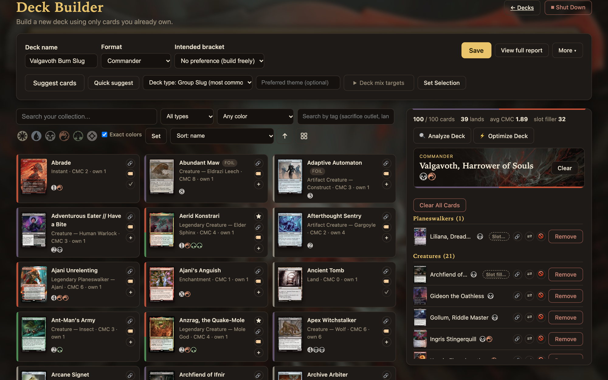

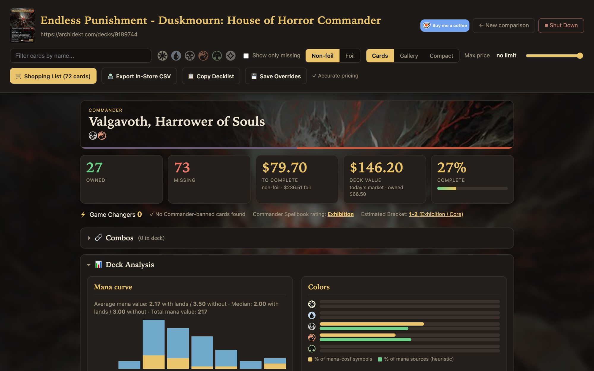

## The Decks page

The **Decks** page is home base for both tools: a **Compare** panel on top
(paste a decklist URL) and your saved decks as art tiles below, badged **Brew**
or **Comparison**, with a filter, a **Brew something new** tile, and a small
&times; to delete one. The app is dark by default and switches to light with
your system.

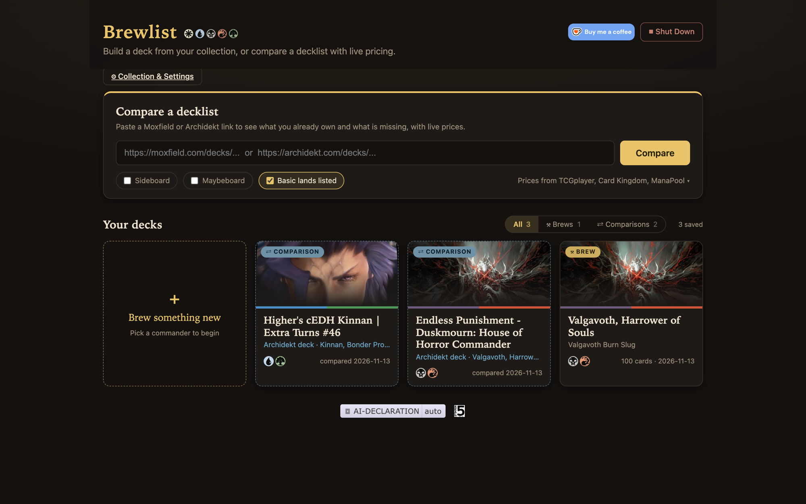

## Deck Builder

Build a deck from what you own at `/builder` (or the **Brew something new**
tile). A saved brew can be run through the same report a compared deck gets.

### Find cards

- Filter by name, type, color or set. Colors go beyond WUBRG to every named
  guild, shard and wedge, with an **Exact colors** option; the color pips cycle
  **allowed**, **required**, off (the colorless pip adds colorless cards, **×**
  clears them all). The **Set** filter is a multiselect, newest first, showing
  how many cards you own of each set. Every dropdown shows live counts
- **Search by tag** uses Scryfall's Oracle Tags (the data behind `otag:`):
  try "sacrifice outlet" or "landfall". The 🏷 button on a tile lists its
  tags. The search box also matches a card's flavor or crossover name
  (type "Chekov" and you get Tatyova)
- **Sort** by name or set (like a binder), or for commanders by popularity or
  completeness. **View** switches between Cards, Gallery and Compact

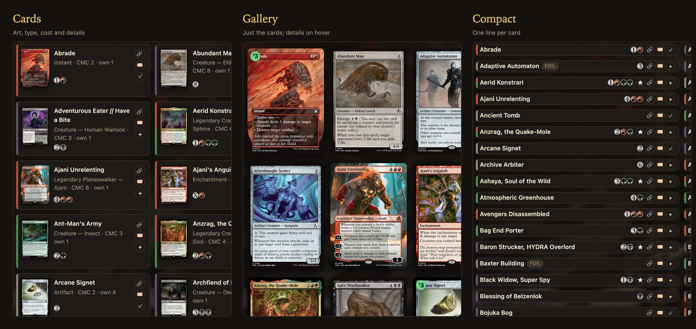

- The 🔗 button opens **Works with...**: owned cards that complement it
  (sacrifice outlets with death payoffs, landfall with land ramp...) plus
  cards that share its rarer tags

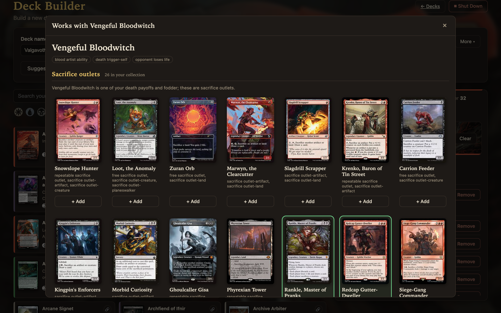

### Build the deck

- **★** sets the commander (set the type filter to **Commander** to see the ones
  you own), **+** adds a card, and you can drag a tile into the deck panel (drop
  a commander on the banner to set it)

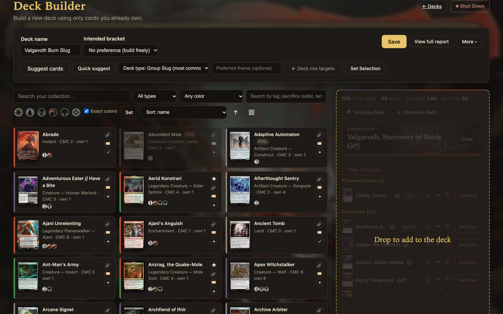

- **Rate my commanders** scores every commander you own by how much of its
  EDHREC deck your collection can fill (slot filler and signature cards show on
  hover), for its most common EDHREC deck type. Sort by **Most complete first**
  to see what you can build best today. Nothing is rated until you click it

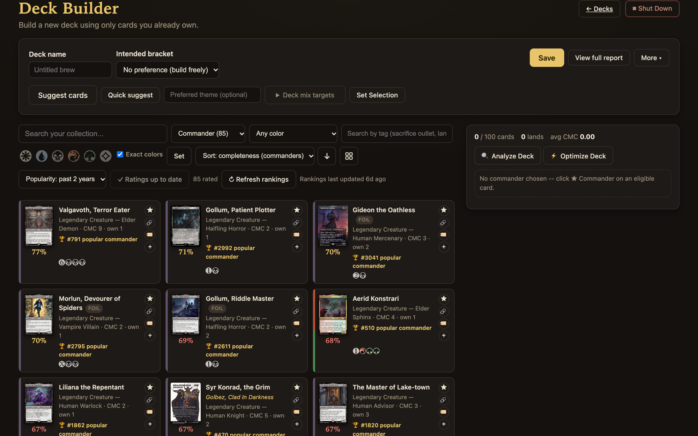

- **Suggest cards** is a guided five-step flow: pick an EDHREC **deck type** for
  your commander, then review Synergy, Ramp, Draw, Interaction and Lands one
  step at a time, with a reason on each pick and **Not owned** or **Slot filler**
  tags where they apply. **Quick suggest** takes the whole list at once. Picks are ranked by combos you're one card from finishing
  (Commander Spellbook), then EDHREC synergy scores and Oracle Tags, then
  whatever the deck's shape (default 38 lands / 10 ramp / 10 draw / 11
  interaction / 30 synergy) still needs. No API key or per-build cost, and
  nothing is added until you approve it

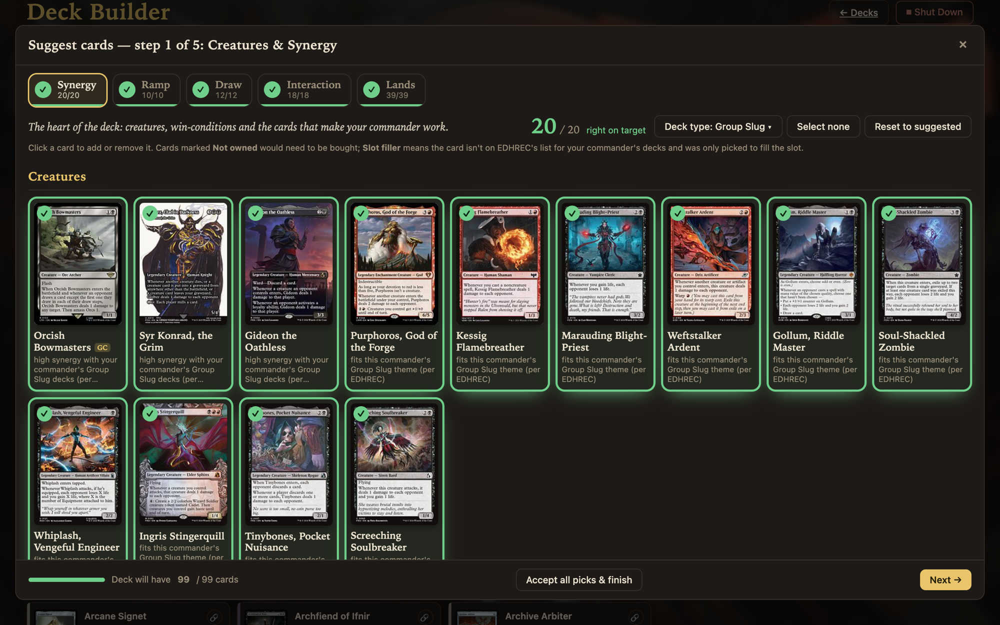

- **Engine commanders** (Teysa and Aristocrats, Kwia and Lifegain) get a
  plan-aware build that ranks enablers and payoffs first, and the standard
  shape is kept if the plan version's goldfish odds are clearly worse
- Options: a **Preferred theme** (Voltron, Reanimator, Stax, ...), **Set
  Selection** to limit which sets Suggest may use, **Intended bracket** to
  avoid too many Game Changers, and **Deck mix targets**
- **⇄** on a deck card suggests owned replacements for the same role.
  **Optimize Deck** looks for owned one-card-away combos and proposes swaps

### Analyze, save and export

- **Analyze Deck** shows a **Rule 0 summary** (colors, bracket, Game Changers,
  mass land denial, extra turns), combos, the mana curve and a sample hand,
  colored sources against Karsten's numbers, a **mana simulation**, a **Turn
  Clock** (how fast the deck kills an opponent who does nothing), a
  **Resilience** check, and **Synergy Packages**. **Print Battle Card** makes a
  one-page summary for the table

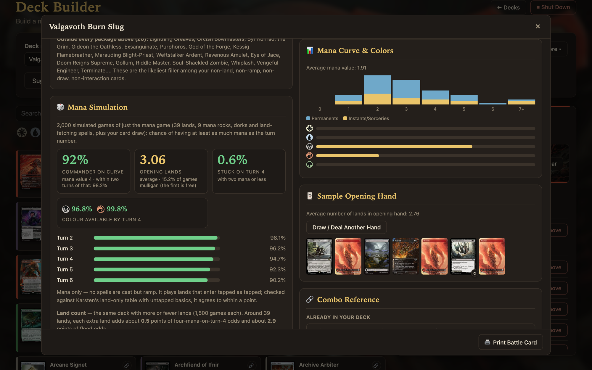

- **Save** keeps it on the Decks page. **View full report** runs it through the
  compare report. **Copy Decklist** (your exact printings) pastes into Moxfield
  or Archidekt, and **Export CSV** gives a binder-ordered list for pulling the
  cards

## Compare a decklist

Paste a Moxfield or Archidekt link on the Decks page:

- See what you own and what's missing, with prices at today's market. Owned
  cards are priced by the *exact printing you have*, missing ones by the
  cheapest printing across TCGPlayer, Card Kingdom and ManaPool (Cardmarket is
  an opt-in extra, shown separately in EUR), with a foil toggle and ▲/▼ trend
  arrows from MTGJSON's 90-day history
- Prices come from a local MTGJSON index (a one-time ~325MB download,
  refreshed weekly or on demand), so lookups are instant
- For missing cards over $20, **budget alternatives** from Scryfall's Oracle
  Tags (or the one you already own), no AI guesses

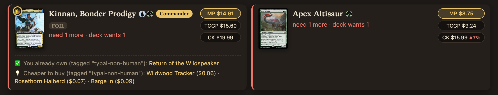

- **Game Changers** and banned/not-legal cards are badged, with header counts
- A **Combos** panel lists combos you have and ones you're one card from
  (Commander Spellbook), and an **Estimated Bracket** follows WotC's published
  rules (1-2, 3 or 4+)

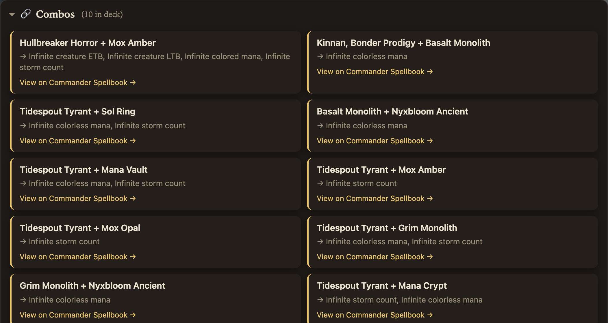

- Deck value, a **Deck Analysis** panel (curve, colors, sample hand), a
  **Shopping List**, an **In-Store CSV** grouped like a store's binders, a price
  slider, and per-card "reserved for another deck" overrides that are
  remembered
- The same **View** menu and flavor-name search as the builder, and a blurred
  commander-art backdrop

## Requirements

- Python 3.9+ (developed and tested on 3.14)
- pip
- git (needed to install and to check for updates -- see below)

## Install

```bash
git clone https://github.com/sevensixtwox51/brewlist.git
cd brewlist
pip3 install -r requirements.txt
```

If your Python install is "externally managed" (common on macOS with
Homebrew Python) and `pip3 install` refuses to run, add
`--break-system-packages`:

```bash
pip3 install --break-system-packages -r requirements.txt
```

On Windows, use `pip` and `python` instead of `pip3`/`python3` if those
aren't recognized (depends on how Python was installed).

## Updating

Both the web app and the CLI check for updates when they launch and only say
something if there is one (a banner on the Setup or Decks page, or a line in
the terminal). To check on demand, use the **Check for Updates** button on the
Setup page, or:

```bash
python3 brewlist_cli.py --update
```

Either one runs a plain `git pull`, so it only works if you installed with
`git clone` (not a downloaded ZIP). Restart the app afterward to run the new
code.

## Usage: web app (recommended)

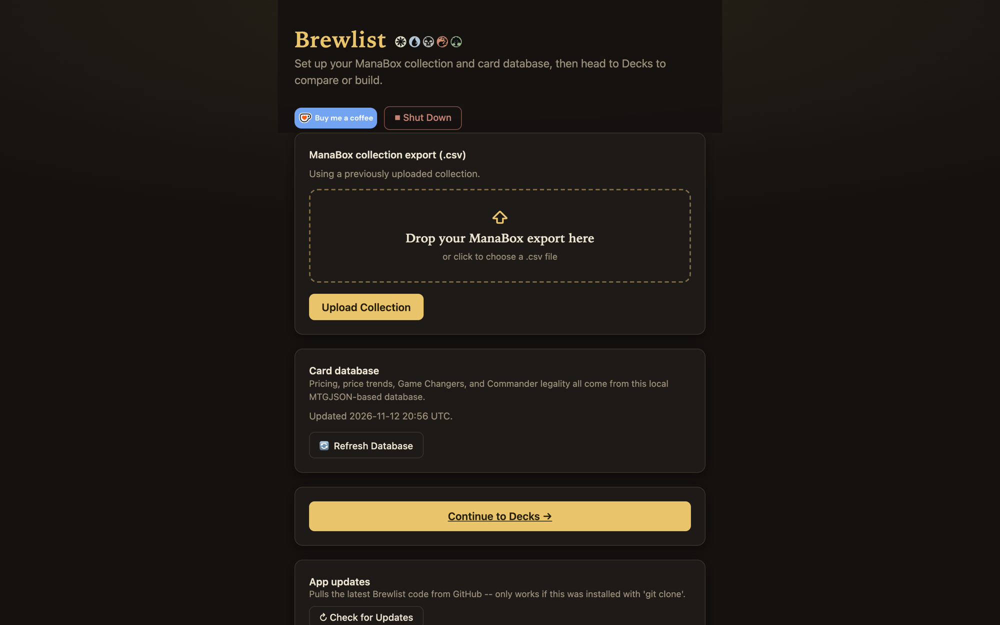

Launch it:

- **macOS:** double-click `Brewlist.command`. If macOS says it can't be opened
  because it's from an unidentified developer (it does that when the file came
  from a ZIP download rather than `git clone`), right-click it and choose
  **Open**, or run `xattr -dr com.apple.quarantine Brewlist.command` once
- **Windows:** double-click `Brewlist.bat`
- **Linux:** run `./brewlist.sh` from a terminal
- **Any OS:** `python3 app.py`

It picks a free port (starting at 5050, since macOS's AirPlay Receiver often
uses 5000) and opens your browser. Close the terminal or use **Shut Down** to
stop it. If the server stops answering, a banner says so and points you to Copy
Decklist so an open deck isn't lost. It also **quits by itself after 15 minutes
of no use** (a tab left open doesn't count, and it never stops mid-job). Set
`BREWLIST_IDLE_EXIT_MINUTES` to change that (minimum 2, or `0` to turn it off;
it's off in Docker). `PORT`, `HOST` and `NO_BROWSER=1` are also available.

It opens to a **Setup** page: upload your ManaBox collection export (`.csv`;
drag it onto the drop zone or click to choose it) and hit **Continue to Decks**.
The collection is remembered, so you only return to Setup (the **⚙ Collection &
Settings** link) to replace it.

**To build a deck**

1. On the **Decks** page, click **Brew something new**
2. Pick a commander: set the type filter to **Commander** to list the ones you
   own (**Rate my commanders** shows which you can build best), then hit **★**
3. Hit **Suggest cards** and review the picks (or **Quick suggest**), then add or
   swap cards by hand
4. **Analyze Deck**, then **Save**, **Copy Decklist** or **View full report**

**To compare a decklist**

1. On the **Decks** page, paste a Moxfield or Archidekt deck URL
2. Hit **Compare**

Both tools use a local card database (prices, legality, Game Changers, Oracle
Tags). The first run downloads about 325MB from MTGJSON, which takes under a
minute, and then it's refreshed weekly or from the Setup page's **Refresh
Database** button. Each deck is remembered as a "project": a brew picks up where
you left off, and a compared deck recalls its saved overrides and options the
next time you paste the same URL.

## Usage: Docker

A `Dockerfile` and `docker-compose.yml` are included for the web app (the
CLI isn't containerized). There's no published image — Docker builds it
from source, so you still need the repo on your machine first:

1. Install [Docker Desktop](https://www.docker.com/products/docker-desktop/)
   (macOS/Windows) or Docker Engine + the Compose plugin (Linux), and make
   sure it's running.
2. Clone the repo (same as the [Install](#install) step above — no need
   for the `pip3 install` part, the container handles its own
   dependencies):
   ```bash
   git clone https://github.com/sevensixtwox51/brewlist.git
   cd brewlist
   ```
3. Build and start it:
   ```bash
   docker compose up -d
   ```

Then open `http://localhost:5050`. Your ManaBox collection, saved
decks/brews, and the local MTGJSON price index live in a named Docker
volume (`brewlist-data`), so they survive `docker compose down` and
rebuilds — remove that volume if you ever want a clean slate.

To use a different host port, edit the `ports:` line in
`docker-compose.yml` (e.g. `"6000:5050"`), or without Compose:

```bash
docker build -t brewlist .
docker run -p 5050:5050 -v brewlist-data:/app/data brewlist
```

The in-app **Check for Updates** button can't pull updates from inside the
container itself (there's no git checkout in there to pull), so clicking
it just tells you to update from the host instead — same two commands
either way:

```bash
git pull
docker compose up -d --build
```

## Usage: CLI

```bash
python3 brewlist_cli.py
```

Menu-driven — it'll ask for the deck URL, look for a ManaBox export in
`~/Downloads` (or wherever you point it), and let you choose which report
formats to generate (HTML / Markdown / CSV, or all three).

Or scripted, for automation — `--open` generates the HTML report and opens
it in your browser:

```bash
python3 brewlist_cli.py https://moxfield.com/decks/... --open
```

(An Archidekt URL works the same way: `https://archidekt.com/decks/... --open`.)

Every card is priced from its cheapest printing using the local card
database described above (downloads automatically the first time, then
instant). Use `--refresh-price-index` on its own to force-update that
database sooner than its automatic weekly refresh.

Run this for the full flag list:

```bash
python3 brewlist_cli.py --help
```

## Where your data lives

Everything the app remembers — your uploaded collection, any saved
per-deck overrides, your store-pricing preference, and the local card
database (see above) — is stored locally under `data/`, which is
excluded from version control (`.gitignore`). Nothing leaves your
machine except the calls to Moxfield's, Archidekt's, Scryfall's,
MTGJSON's, EDHREC's, and (for Commander decks) Commander Spellbook's
public APIs/pages needed to fetch decklists, prices, combos, and
commander popularity/synergy data.

## Uninstalling

**Non-Docker:** stop the app (the **Shut Down** button, or close the
terminal window), then delete the folder you cloned into. Everything
Brewlist stores — your collection, saved decks, the price index — lives
inside that same folder under `data/`, so deleting it removes everything
in one step. The `flask`/`rich`/`pyfiglet` packages `pip3 install`d
earlier are small, shared Python libraries other tools may also use, so
there's no need to remove them separately unless you want to
(`pip3 uninstall flask rich pyfiglet`).

**Docker:**

```bash
docker compose down --rmi all -v
```

Stops and removes the container, the image Docker built, and the
`brewlist-data` volume (your collection, price index, saved decks) in one
step. Then delete the cloned folder the same way as above.

## Support

Brewlist is a free, personal project — if it's saved you time or money
building your next deck, consider [buying me a coffee on
Ko-fi](https://ko-fi.com/imtotallymeh). Not required, but always
appreciated!

## Project layout

| File | Purpose |
| --- | --- |
| `brewlist_core.py` | Shared logic: Moxfield/Archidekt/Scryfall/MTGJSON fetching, ManaBox parsing, price comparison, HTML report rendering. No UI dependencies — imported by both entry points below. |
| `deck_builder.py` | Deck Builder logic: owned-collection browsing data, the fill-the-gaps Suggest heuristic (now synergy-weighted, see `edhrec_data.py`), the Optimize combo-completion pass, brew-to-report conversion. No UI dependencies — imported by `app.py` only (the Deck Builder is web-app only). |
| `edhrec_data.py` | EDHREC commander-popularity ranks and per-commander card synergy scores — the real, non-AI data source behind the Deck Builder picker's popularity badges and Suggest/Optimize's synergy weighting. No UI dependencies — imported by `deck_builder.py`/`app.py`. |
| `synergy.py` | Deck-plan recognition: what an engine commander wants (sacrifice, tokens, counters, ...), used by the autobuilder and the plan guard. |
| `tag_synergy.py` | Scryfall Oracle Tags from the local card database: tag search, "Works with…" and similar-card suggestions. |
| `mana_sim.py`, `turn_clock.py` | Goldfish simulations behind the Analyze panel's Mana Sim and Turn Clock. |
| `index_worker.py` | Runs Refresh Database in its own process so the web app stays responsive while it downloads and rebuilds. |
| `app.py` | Flask web app, including the Deck Builder (`/builder`). Its `static/` folder holds the mana-symbol SVGs. |
| `brewlist_cli.py` | Terminal CLI (interactive menu or scriptable flags). |
| `Brewlist.command` | macOS double-click launcher for the web app. |
| `Brewlist.bat` | Windows double-click launcher for the web app. |
| `brewlist.sh` | Linux/other-POSIX launcher for the web app (run from a terminal). |

## AI disclosure

This project is built almost entirely by AI (Claude Code) — see
[AI-DECLARATION.md](AI-DECLARATION.md) for what that means in practice.
That's about the *code*, though — every feature the app itself runs
(pricing, legality, budget alternatives, Suggest, Optimize, commander
popularity/synergy) is a deterministic heuristic over real data
(Scryfall Oracle Tags, MTGJSON, Commander Spellbook, EDHREC), explicitly
*not* an AI guess. The app makes no AI calls at runtime.

<p align="center">
  <a href="AI-DECLARATION.md"></a>
  <a href="https://www.realgoodai.org/real-rating"></a>
</p>
